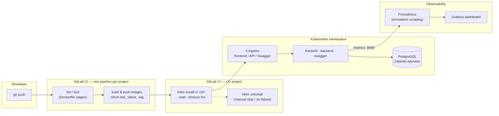

# Todo App — Containerization, CI/CD and Kubernetes

DevOps coursework: taking a small Go + Vue application and building everything around it — Docker
images, CI pipelines, Kubernetes manifests, a Helm chart, a continuous-deployment pipeline that
creates and destroys an ephemeral environment in a shared cluster, and the observability that goes
with it.

> **Attribution.** The application itself — the Go API, the Vue SPA and both end-to-end test suites
> — was written by **Lucas Granet**, the author of the course, and is included here as the subject
> of the exercise. **My work is everything around it**: the Dockerfiles, the GitLab CI pipelines,
> the Kubernetes manifests, the Helm chart, the CD pipeline, the database operator migration and the
> Grafana dashboard. The Docker and Kubernetes work was done with **Théo Demaria**; the commit
> history shows who did what.

## Architecture



## Layout

| Path | What it is | Author |
|---|---|---|
| [`ci-cd/`](ci-cd) | Kubernetes manifests, Helm chart, CD pipeline, Grafana dashboard, Compose stack | mine |
| [`backend/`](backend) | Go + Echo + GORM REST API — `Dockerfile` and `.gitlab-ci.yml` are mine | app: Lucas Granet |
| [`frontend/`](frontend) | Vue 3 + Vite SPA — `Dockerfile` and `.gitlab-ci.yml` are mine | app: Lucas Granet |
| [`e2e-backend/`](e2e-backend) | Ginkgo end-to-end suite | Lucas Granet |
| [`e2e-frontend/`](e2e-frontend) | Cypress end-to-end suite | Lucas Granet |

Each directory keeps its own README. The most detailed one is [`ci-cd/README.md`](ci-cd/README.md):
prerequisites, commands, and the reasoning behind each choice.

## What I built

**Multi-stage Docker images where every check is a build stage.** `docker build --target lint .`
and `--target test .` run exactly what CI runs, so a check can never drift between a laptop and the
runner. The backend image also has an `openapi` stage that generates the spec and a `swagger` stage
that serves it.

**CI pipelines** (`lint → test → build → deploy`) that push every image as `:<short-sha>`, plus
`:latest` on the default branch and `:<tag>` on a git tag — so a deployment can always name the
exact commit it runs.

**Kubernetes deployment, twice over.** [`ci-cd/k8s/`](ci-cd/k8s) holds plain manifests that read
without knowing Helm; [`ci-cd/helm/`](ci-cd/helm) packages the same application as a chart whose
resources are all prefixed with the release name, so several versions can live side by side in one
namespace. Health probes hit the API's separate health port, which therefore never needs to be
exposed through a Service.

**Continuous deployment with a real ephemeral environment.** Every pipeline installs its own release
into a dedicated namespace, with its own hostnames, and registers it as a GitLab environment with
an *Open* button and a manual *Stop*. If the deployment fails, an `after_script` uninstalls the
release — the cluster is never left dirty. The pipelines of the application repositories trigger
this one and pass the commit SHA they just built, so the CD deploys that exact image.

**PostgreSQL through the Zalando operator** instead of a hand-written Deployment: the repository
describes a single `postgresql` resource, and the operator creates the StatefulSet, the persistent
volume, the Services and one credentials secret per user. Consequence worth having: **no password
anywhere in the repository** — the API reads its credentials from the generated secret.

**Observability without a ServiceMonitor.** Student accounts cannot create one on this cluster, so
collection goes through `prometheus.io/*` pod annotations. The
[Grafana dashboard](ci-cd/grafana/dashboard.json) is versioned here, and its queries filter on the
application's own hostname — otherwise the ephemeral CD environments inflate every curve.

## Measured, not guessed

A four-minute load test (~20 req/s, 4 854 requests) against the deployed application:

| Metric | Value | Why it matters |
|---|---|---|
| CPU | **20 millicores** | the pods reserve 100m, so the request is right-sized |
| Memory | **25 MB** | against a 100 Mi limit — no risk of being OOM-killed |
| Average latency | **0.94 ms** | p95 barely above it |
| 5xx | 0 | the API only returns 500 when the database is unreachable |

## Running it locally

The Compose stack is the one thing a visitor can actually run — the CI/CD pipelines target a GitLab
instance and a Kubernetes cluster that belong to the school.

```bash
cd ci-cd
docker compose up --build
```

| Service | URL |
|---|---|
| Frontend | <http://localhost:5173> |
| API | <http://localhost:8080/api/todos> |
| Health and metrics | <http://localhost:9090/healthz>, `/readyz`, `/metrics` |
| Swagger UI | <http://localhost:8081> |

## Notes for the reader

- The pipelines are **GitLab CI**, not GitHub Actions: they will not run here. They are included
  because they are a substantial part of the work.
- Hostnames, registry paths and namespaces refer to the school's infrastructure and are kept as-is,
  so the manifests stay readable as what was actually deployed.
- No licence is attached: the application is not mine to license. Ask Lucas Granet about reusing it,
  and feel free to ask me about the infrastructure work.
